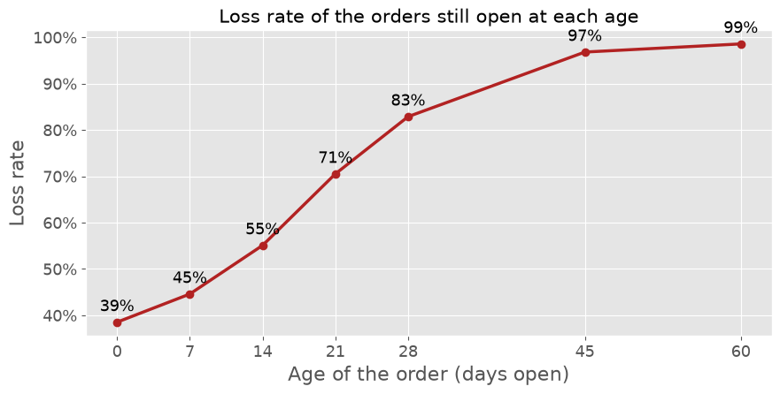
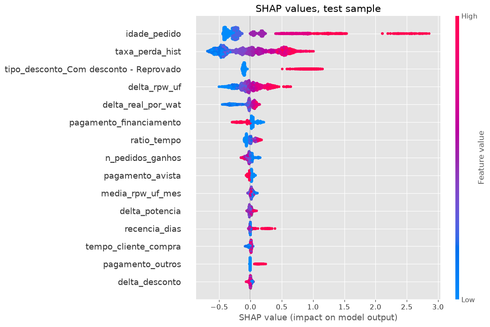

# Sales Loss Prediction

Predicting which open sales orders will be lost, with **XGBoost**, **SHAP** and a validation designed to avoid leakage.

This project is a portfolio version of a model I built and put into production at a distributor of solar energy equipment. The customers are solar installers, and the sales team uses the model every day to decide which open orders to call first. The company data cannot be published, so the whole project runs on **synthetic data** that keeps the structure of the original database (same tables, columns and business rules).

## Main results

| Model | Evaluation | AUC |
|-------|------------|-----|
| Original approach | its own validation | 0.762 |
| Original approach | real conditions of use | **0.693** |
| Snapshot approach (final) | real conditions of use | **0.752** |
| Real probability (theoretical ceiling) | at order creation | 0.758 |

The most important variable of the original model, *time of the order compared with the customer's usual time*, was calculated with the **final** time of the order in training, but with the **elapsed** time in production. Its validation promised an AUC of 0.76 that it could not deliver. Training on **snapshots** of each order at several ages fixed the problem.



Other points covered in the notebooks:

- **Point-in-time customer history:** the usual cumulative sums ordered by creation date silently use outcomes from the future.
- **The order stage as a feature gives AUC = 1.0**, a textbook leakage.
- **Early stopping on a validation window**, never on the test set.
- **Right-censoring:** recent orders are kept out of the evaluation.
- **Comparison with the real probability**, only possible because the data is synthetic: the model captures about 80% of the discrimination that is possible above a random guess.
- **SHAP explanations** translated into three reasons per order for the sales team, plus an interaction between payment method and order age that a naive reading of SHAP would get wrong.



## Notebooks

| Notebook | Content |
|----------|---------|
| [01. Synthetic data](notebooks/01_synthetic_data.ipynb) | How the fake database is generated, with the real loss probability saved apart |
| [02. Exploratory analysis](notebooks/02_exploratory_analysis.ipynb) | Loss rate by time, payment, discount, price and state |
| [03. Features](notebooks/03_features.ipynb) | Order variables, point-in-time history and the snapshot base |
| [04. Model](notebooks/04_model.ipynb) | Temporal split, leakage comparisons, evaluation, SHAP and ranking of the open orders |

## How to run

```bash
python -m venv .venv
.venv\Scripts\activate          # Windows (on Linux/macOS: source .venv/bin/activate)
pip install -r requirements.txt
```

Run the notebooks in order. Notebook 01 creates the data in `data/` (about 9 MB), so nothing needs to be downloaded. Everything uses a fixed seed and a fixed reference date, so the results are reproducible.

## In production

The original pipeline (not reproduced here, since it depends on the company infrastructure) runs as:

- a **daily job** that scores the open orders;
- a **weekly job** that retrains the model and only promotes the new version if its AUC does not drop more than 0.02 (every training is logged);
- a **FastAPI** service that delivers the ranking, with priority level and reasons, to the sales system.

## Author

**Hugo Batista da Silva**, statistician (UFES) and data scientist.
[LinkedIn](https://www.linkedin.com/in/hugo-batista-da-silva-064715257/) · [Portfolio](https://batistugo.github.io/MyDataPortfolio/)
